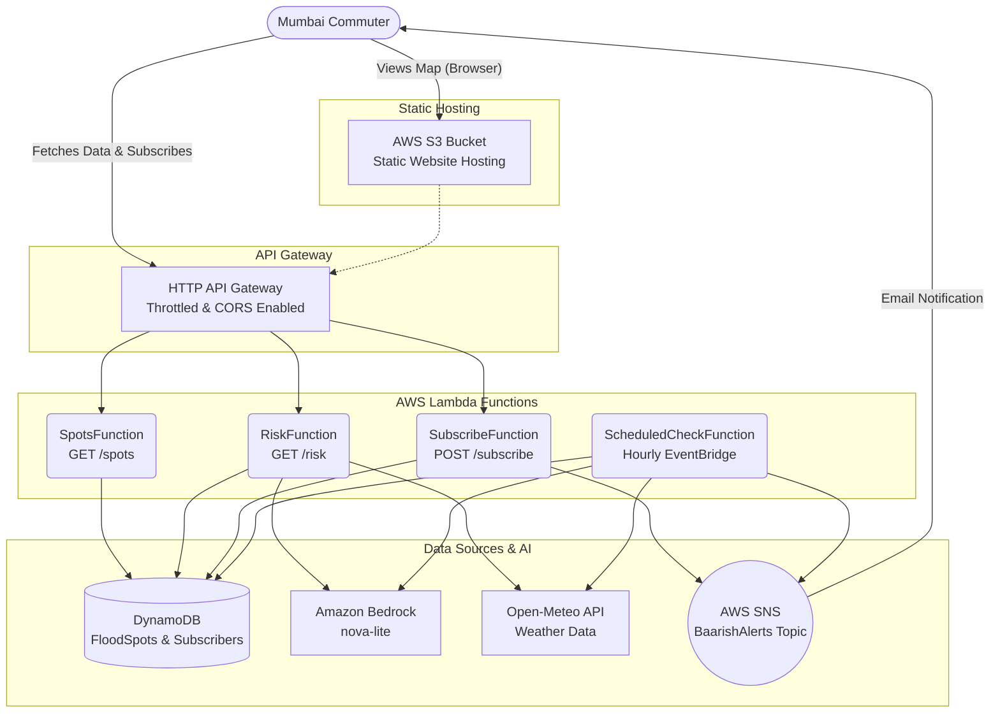

# BaarishSaathi (बारिश साथी) 🌧️

> **Mumbai Monsoon Waterlogging Early-Warning & Alternate Route Advisor**  
> Built for the *WeMakeDevs x AWS Hackathon* (Heat & Water Track).

BaarishSaathi provides Mumbai commuters with hyper-localized, real-time monsoon flood risk alerts, plain-language advisory, and safer elevated bypass routes to avoid getting stranded during heavy cloudbursts and high tides.

---

## 🎯 The Problem
Every monsoon season, Mumbai commuters face severe disruptions due to localized waterlogging. Popular bottlenecks like Milan Subway, Hindmata, and Andheri Subway flood rapidly, leading to massive traffic jams, vehicle damage, and stranded citizens. Existing weather apps provide generic city-wide rain forecasts, but commuters need **hyper-local risk assessments** tied to specific traffic choke points.

## 💡 The Solution
BaarishSaathi solves this by marrying hyper-local Open-Meteo rainfall forecasts with historical chronic flood spot data. It dynamically computes a risk score (0-100) and uses **Amazon Bedrock (Generative AI)** to translate the data into calm, tri-lingual (English, Hindi, Marathi) advisories with actionable alternate route suggestions. Users can also subscribe via email to receive automated high-risk alerts for their daily commute routes.

---

## 🚀 Features
- **Interactive Leaflet Map**: Real-time visualization of 15 chronic Mumbai flood spots, color-coded by current risk level (Low / Medium / High).
- **Intelligent Risk Scoring Algorithm**: Evaluates a combination of 3-hour rainfall, 24-hour rainfall, precipitation probability, historical spot severity, and elevation (low-lying status).
- **Tri-Lingual AI Advisories**: Amazon Bedrock translates complex meteorological data into easily digestible, multi-lingual alerts for local citizens.
- **Automated SNS Alerts**: Users can subscribe to their specific commute bottleneck and receive targeted email alerts via AWS SNS when danger thresholds are breached.
- **Serverless & Ultra-Fast**: Built on a 100% AWS serverless backbone ensuring high availability, zero cold-start latency, and near-zero idle costs.

---

## 🏗️ Architecture Diagram



---

## ☁️ AWS Services Used & Why
- **Amazon S3**: Hosts the static, zero-build-step vanilla JS/HTML frontend. Ultra-cheap and infinitely scalable. *(Note: Deployed via S3 Static Website Hosting (HTTP) due to new-account AWS restrictions that block the immediate creation of CloudFront distributions for HTTPS.)*
- **AWS API Gateway (HTTP API)**: Provides a lightweight, fast, and throttled entry point for our backend APIs to prevent abuse.
- **AWS Lambda (Python 3.11)**: Serverless compute handles real-time risk calculations and cron jobs without paying for idle server time.
- **Amazon DynamoDB**: NoSQL document store perfectly suited for low-latency retrieval of static flood spot metadata and tracking user subscriptions.
- **Amazon Bedrock (`amazon.nova-lite-v1:0`)**: Provides hyper-fast, intelligent, and locally tailored natural language generation to translate raw rain data into empathetic commuter alerts.
- **Amazon SNS**: Handles pub/sub message fan-out and email delivery with built-in `FilterPolicy` so users only get emails for their subscribed spots.
- **Amazon EventBridge**: Triggers the `ScheduledCheckFunction` every hour to automatically monitor all spots in the background.

---

## 💰 Cost Estimate
This entire architecture is built to stay comfortably within the AWS Free Tier, specifically targeting the hackathon requirement of **under $20**.
- **Lambda**: ~0 cost (well within 1M free requests/month).
- **API Gateway**: ~0 cost (first 1M free).
- **DynamoDB**: On-demand pricing, negligible cost for <100 reads/writes per day.
- **Bedrock (Nova-Lite)**: ~$0.00006 per 1,000 input tokens. Virtually $0 for a small demo.
- **S3 & SNS**: Effectively $0 for hackathon scale.
- **Total Projected Cost**: **<$0.50 per month**.

---

## ⚠️ Limitations & Disclaimers
1. **Data Source Validation**: The hotspot coordinates and severity ratings in this app are based on historical observations and common knowledge. **They must be verified against official Brihanmumbai Municipal Corporation (BMC) disaster management bulletins.**
2. **Rule-Based Scoring**: The risk algorithm relies on heuristic weights (e.g., 40% for next 3h rain, 25% for 24h rain). It does not account for complex hydrological modeling like ground saturation or soil drainage rates.
3. **Open-Meteo Reliability**: The app uses the free-tier Open-Meteo API, which may rate-limit aggressive polling.
4. **Email Confirmation**: AWS SNS requires users to explicitly click a confirmation link in their email before receiving alerts.
5. **HTTP Hosting**: The frontend is currently hosted on an S3 Static Website Endpoint (HTTP). Implementing HTTPS via CloudFront is the intended architecture, but could not be provisioned due to AWS restrictions on newly created accounts.
6. **Bedrock AI Fallback**: If Bedrock model access (Nova-Lite) is pending approval in the AWS console, the app will gracefully fall back to a rule-based natural language template without crashing.

---

## 🔮 Future Work
- **Tide Data Integration**: Mumbai flooding is severely exacerbated when heavy rainfall coincides with a high tide. Integrating real-time BMC tide charts would drastically improve risk accuracy.
- **WhatsApp Alerts**: Transitioning from Email to WhatsApp via the Meta Graph API or Twilio, as it is the primary communication tool for Indian commuters.
- **Ward-level Micro-Data**: Integrating live data from the 60+ automatic weather stations (AWS) maintained by the BMC across specific city wards.
- **Crowdsourced Reports**: Allow users to click a "Waterlogging Detected Here" button to temporarily boost a spot's risk score for 2 hours based on real-time community consensus.

---

## ⚙️ Setup Instructions
1. Install **AWS CLI** and **AWS SAM CLI**.
2. Run `aws configure` to set your credentials.
3. Run the deployment script:
   ```bash
   ./deploy.ps1
   ```
4. Seed the database with the pre-configured hotspots:
   ```powershell
   $env:FLOOD_SPOTS_TABLE="FloodSpots"
   $env:AWS_REGION="ap-south-1"
   python data/seed.py
   ```