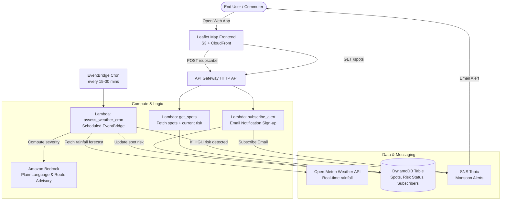

# BaarishSaathi - Project Implementation Plan

> **Mumbai Monsoon Waterlogging Early-Warning & Safer Alternate Route Advisor**  
> Built for *WeMakeDevs x AWS Hackathon* (Heat & Water Track)

---

## 1. Architecture Overview



---

## 2. Proposed Folder Structure

```text
BaarishSaathi/
│
├── README.md
├── plan.md                                # Hackathon roadmap & architecture
├── template.yaml                          # AWS SAM template (IaC)
├── samconfig.toml                         # SAM deployment configuration
│
├── backend/
│   ├── handlers/
│   │   ├── get_spots.py                   # GET /spots (returns flood spots with live risk level)
│   │   ├── assess_weather.py              # EventBridge cron: Open-Meteo -> Risk -> Bedrock -> DynamoDB -> SNS
│   │   └── subscribe_alert.py             # POST /subscribe (register user email for high-risk spot alerts)
│   ├── utils/
│   │   ├── bedrock_client.py              # Bedrock prompt invocation (Amazon Titan / Claude 3 Haiku)
│   │   ├── weather_client.py              # Open-Meteo API caller & rainfall parser
│   │   └── spots_seed_data.json           # Known Mumbai flood hotspots (Hindmata, Milan Subway, etc.)
│   └── requirements.txt                   # Lambda dependencies (boto3, requests, etc.)
│
├── frontend/
│   ├── index.html                         # Semantic HTML5 single-page application
│   ├── style.css                          # Modern vanilla CSS (Dark/Monsoon aesthetic, responsive)
│   ├── app.js                             # Vanilla JS + Leaflet map controller & API client
│   └── assets/
│       ├── icons/                         # Pin/risk marker icons (Green, Yellow, Red)
│       └── logo.svg                       # BaarishSaathi branding
│
└── scripts/
    ├── seed_dynamodb.py                   # One-time script to populate initial flood hotspot metadata
    └── test_local.py                      # Local integration test script to verify weather & Bedrock
```

---

## 3. High-Priority Mumbai Flood Hotspots (Seed Data)

The app will launch pre-loaded with chronic Mumbai waterlogging locations:
1. **Milan Subway (Santacruz)** – Prone to rapid inundation; Alternate: Milan Flyover / SV Road.
2. **Andheri Subway** – Chronic underpass flooding; Alternate: Gokhale Bridge / Balasaheb Thackeray Flyover.
3. **Hindmata Cinema (Dadar East)** – Classic depression point; Alternate: Dr. B.A. Road Flyover.
4. **King's Circle / Gandhi Market (Sion)** – Central railway underpass waterlogging; Alternate: Sion Flyover / Eastern Express Highway.
5. **Kurla Kamani / LBS Marg** – Mithi River overflow vulnerability; Alternate: BKC Connector / SCLR.
6. **Malad Subway** – Low-lying suburban underpass; Alternate: Malad Flyover.
7. **Sion Station / Circle** – Road & track flooding; Alternate: Lal Bahadur Shastri Marg / EEH.
8. **Dahisar Subway** – North Mumbai suburban chokepoint; Alternate: Western Express Highway flyovers.

---

## 4. Key AWS Services & Cost Safeguards

| Component | AWS Resource | Role in BaarishSaathi | Cost / Safeguard |
|---|---|---|---|
| **API** | HTTP API Gateway | Lightweight, low-latency REST endpoints (`/spots`, `/subscribe`) | Pay-per-call (~$1.00/million calls; well within free tier) |
| **Compute** | AWS Lambda (Python 3.12) | Microservices for reading spots, weather assessment, and subscription | Free Tier (1M req/mo) |
| **Database** | Amazon DynamoDB | On-Demand (PAYG) single table for spots, live risks, and alerts | Free Tier (25 GB storage) |
| **Scheduler** | Amazon EventBridge | Cron rule triggers weather assessment periodically | Free |
| **Notifications** | Amazon SNS | Publishes email alerts to commuters | Free Tier (1,000 email notifications/mo) |
| **AI / GenAI** | Amazon Bedrock | Generates plain-language Marathi/Hindi/English localized advisory and alternate route | On-demand tokens (Amazon Titan Text Express / Claude 3 Haiku: <$0.01 per run) |
| **Hosting** | S3 + CloudFront | Static website hosting with global CDN and HTTPS | Free Tier (1 TB data transfer out) |

*Total projected infrastructure cost for the 2-day hackathon & judging demo: **<$1.00**.*

---

## 5. Implementation Step List

- [ ] **Step 1: Backend Foundation & SAM Template (`template.yaml`)**
  - Define DynamoDB `SpotsTable` with Partition Key `spot_id`.
  - Define SNS Topic `MonsoonAlertsTopic`.
  - Define HTTP API Gateway with CORS enabled.
  - Define Lambdas: `GetSpotsFunction`, `AssessWeatherFunction`, `SubscribeAlertFunction`.
  - Set up least-privilege IAM policies (DynamoDB read/write, Bedrock invoke, SNS publish).

- [ ] **Step 2: Weather Ingestion & Risk Scoring Engine**
  - Implement Open-Meteo client fetching hourly precipitation, rain sum, and weather code for Mumbai coordinates (19.0760° N, 72.8777° E and local spot bounding boxes).
  - Implement heuristic risk scoring algorithm:
    - `LOW`: < 5 mm/hr rain, no high tide conflict.
    - `MEDIUM`: 5 - 15 mm/hr rain or continuous moderate rainfall.
    - `HIGH`: > 15 mm/hr rain or high tide alert (triggers SNS warning).

- [ ] **Step 3: Bedrock GenAI Advisory Integration**
  - Prompt Bedrock with current spot rainfall, flood history, and surrounding flyovers.
  - Output concise, commuter-friendly advice:
    - What is happening (plain language)
    - Safe alternate route (e.g., "Take Milan Flyover instead of Milan Subway")
    - Transit advisory (local train / BEST bus alert)

- [ ] **Step 4: Hotspots Seeding & DynamoDB Population**
  - Prepare `spots_seed_data.json` with lat/lon, hotspot names, normal routes, and alternate elevated routes.
  - Script to seed DynamoDB table.

- [ ] **Step 5: Frontend UI Development (Leaflet.js + Vanilla JS/CSS)**
  - Interactive Leaflet map centered on Mumbai with custom color markers (Green = Low, Amber = Medium, Red = High).
  - Collapsible Spot Details drawer showing:
    - Real-time rainfall & waterlogging risk badge.
    - Bedrock-generated plain language summary.
    - Recommended alternate route button.
  - Email Alert Subscription bar (No login needed: simple email input + spot selector).
  - Responsive mobile-first design with high-contrast Monsoon UI theme.

- [ ] **Step 6: End-to-End Integration & Local/Cloud Verification**
  - Test live API endpoints.
  - Test Bedrock fallback logic (graceful static fallback if Bedrock quota or region is delayed).
  - Test email subscription flow and mock high-risk trigger.

- [ ] **Step 7: 3-Minute Demo Polish & Presentation Ready**
  - Seed one or two spots with active simulated `HIGH` risk for instant live demo impact.
  - Verify zero-auth frictionless user flow.
